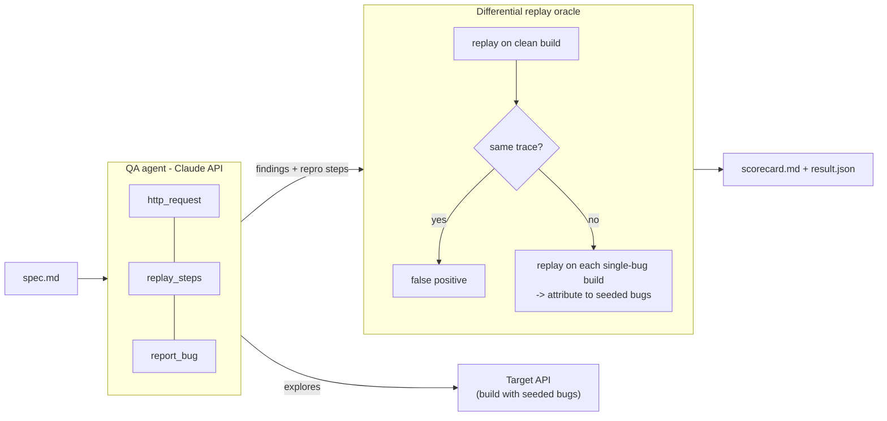

# agentic-qa-bench

[](https://github.com/samiaco99/agentic-qa-bench/actions/workflows/ci.yml)


**How do you know your AI tester is right?** This project answers that with numbers. It
runs an exploratory QA agent against an API with **seeded defects**, and scores every bug
report with a deterministic **differential-replay oracle**. The output is a scorecard with
recall, precision, reproducibility, severity accuracy, and cost.

## Why this project exists

An earlier prototype of mine read a Jira ticket, asked an LLM to test SauceDemo, and wrote
a diagnostic report. That report flagged a **HIGH-severity defect**: opening the cart URL
without a session showed the login page. That is the app's intended auth redirect.

The report looked convincing, and nothing in the pipeline could tell it was wrong. Generating
tests and reports with AI is the easy part. The senior-level problem is **measuring whether
the agent's output is true**, so you can compare models, prompts, and costs with evidence
instead of vibes.

## How it works



1. **Target.** A small ticketing API (FastAPI). Ten defects can be switched on: IDOR,
   promo abuse, rounding, oversell, broken restock, a state-machine hole, a boundary off by
   one, pagination overlap, and an error-contract break. The agent never sees which ones.
2. **Agent.** Claude gets only the product spec and three tools: explore with HTTP
   requests, dry-run a reproduction on a fresh instance, and file a structured bug report.
3. **Oracle.** The app is deterministic, so replaying a finding's steps on the clean build
   and on the buggy build gives identical responses unless a seeded bug is involved.
   Replaying on single-bug builds tells *which* bug a finding demonstrates. No LLM judge is
   involved.
4. **Scorecard.** Recall, precision, F1, invalid repros, duplicates, severity agreement,
   tokens, and estimated cost, as Markdown and JSON.

Design details and threats to validity: [docs/benchmark-design.md](docs/benchmark-design.md).

## Quick start

```bash
python -m venv .venv
source .venv/bin/activate          # Windows: .venv\Scripts\activate
pip install -e ".[dev]"

pytest                              # no API key needed
qabench score tests/fixtures/sample-findings.json   # score sample findings offline
```

Run the built-in agent (uses the Claude API and costs money):

```bash
echo "ANTHROPIC_API_KEY=sk-ant-..." > .env         # git-ignored; or export the variable
qabench run --max-cost 1.50                        # Claude Opus 5.5, effort high, all bugs
qabench run --model claude-sonnet-5-5 --effort medium --max-turns 40 --max-cost 0.75
qabench run --bugs none                            # clean build: measures hallucinated bugs
```

`--max-cost` stops the session once the estimated spend reaches the cap. The agent is
warned at 80% so it can file what it has. Each run writes
`results/<timestamp>-<model>-<effort>/` with `scorecard.md`, `result.json`, and
`transcript.jsonl` (every tool call, for auditing).

### Any MCP agent can take the exam

`qabench mcp` serves the same tools over MCP (stdio), plus `read_specification`. Claude
Code, IDE agents, or local models can then sit the exam with no API key on the benchmark
side. Every report is written to `findings.json` as it happens, and you score it the same
way:

```bash
qabench score results/<stamp>-mcp/findings.json --agent "Claude Code" --save
```

The agent must be isolated from this repository, or it can read the answers. See
[docs/mcp-mode.md](docs/mcp-mode.md).

## Commands

| Command | Purpose |
| --- | --- |
| `qabench run [--model] [--effort] [--bugs] [--max-turns] [--max-cost]` | Run the built-in agent against a build and score it |
| `qabench mcp [--bugs] [--out]` | Serve the exam over MCP for any MCP-capable agent |
| `qabench score FILE [--bugs] [--agent] [--save]` | Score saved findings without calling the API |
| `qabench bugs` | List the seeded bugs (spoilers) |
| `qabench spec` | Print the specification the agent receives |
| `qabench serve [--bugs] [--port]` | Serve the target API locally for manual or Playwright testing |

## Results

First runs, 24 November 2026, with all ten seeded bugs enabled. Costs are estimates from
token counts ([`pricing.py`](src/qabench/pricing.py)). Every run, with its scorecard,
findings, and tool-call transcript, is in [`results/published/`](results/published/).

| Agent | Runs | Bugs found | Precision | Severity agreement | Est. cost per run | Time per run |
| --- | --- | --- | --- | --- | --- | --- |
| Claude Opus 5.5, effort high | 1 | 10/10 | 10/10 | 90% | $0.62 | 189 s |
| Claude Sonnet 5.5, effort high | 1 | 10/10 | 10/10 | 80% | $0.22 | 81 s |
| Claude Haiku 5.5, effort medium | 3 | 8, 8, 9 of 10 | 100% in each run | 50–88% | $0.01–0.02 | 65–88 s |

Clean-build baseline: Haiku 5.5 tested the build with **no** bugs for 86 tool calls and
filed **0** reports.

What the numbers say:

- **No false positives in six runs.** That includes the clean build. My SauceDemo
  prototype had no specification and no way to check a reproduction before reporting.
  Here the agent has both, and every report it filed was real. Six runs is a small sample.
- **The exam is too easy for frontier models.** Sonnet and Opus both scored 100%. At that
  ceiling the benchmark cannot rank them on finding bugs. It only separates them on cost
  (Opus cost about 3× as much) and on severity judgment. The next version needs harder
  defects (see the roadmap). A benchmark only earns trust when someone checks whether it
  still discriminates.
- **Single runs mislead.** Haiku missed a different set of bugs in each run:
  `discount-exceeds-subtotal` and `not-found-error-contract` in the first,
  `events-pagination-overlap` and `order-quantity-upper-bound` in the second, and only
  `order-quantity-upper-bound` in the third.
- **Cost versus quality.** Haiku found 80–90% of the bugs, with no false reports, at
  about 1/40 of the cost of an Opus run.

The verdict types are defined in [docs/benchmark-design.md](docs/benchmark-design.md).
[`tests/fixtures/sample-findings.json`](tests/fixtures/sample-findings.json) is a
hand-written file with one example of each verdict, including a false positive that
repeats the SauceDemo mistake: it reports a required `401` as a defect.

## Project structure

```text
src/qabench/
  target/      system under test: FastAPI app, deterministic store, spec.md, bug registry
  agent/       tool definitions, prompts, and the agentic loop
  mcp_server.py  the same exam served over MCP
  repro.py     reproduction steps and the deterministic replay engine
  scoring.py   differential-replay oracle and metrics
  report.py    Markdown and JSON scorecards
  pricing.py   token-cost estimates
  cli.py       qabench command
tests/         oracle validity, seeded-bug validity, scoring, replay, and loop tests
docs/          benchmark design and threats to validity
```

## Key design decisions

- **Test the test.** The suite proves the oracle before trusting it. The clean build
  conforms to the spec. Every seeded bug is observable, isolated (no bug masks or
  impersonates another), and still visible with all bugs on. The canonical repros score
  100%.
- **Deterministic oracle over LLM-as-judge.** Differential replay is reproducible, free to
  re-run, and cannot be talked into agreeing with the agent.
- **Reproducibility is scored.** A report a developer cannot replay counts against the
  agent, even if the bug is real.
- **The agent cannot see the answers.** It runs fully in-process with no network, gets only
  the spec, and its tools never reveal which bugs are on.
- **Agent-agnostic.** The same tools are served to the built-in API agent and over MCP,
  so different agents are graded by the same oracle on the same exam.
- **A hand-written agent loop.** It enforces a hard turn budget and a cost cap, accounts
  tokens on every turn, logs every tool call for audit, and stops cleanly on refusals or
  truncated turns.
  It uses prompt caching, adaptive thinking with a configurable effort, and server-side
  refusal fallbacks where the model supports them.
- **CI without secrets.** Lint, strict typing, tests, and an offline scoring run happen on
  every push. Agent evals run as a manual workflow, because each run costs money.

## CI

- **[ci.yml](.github/workflows/ci.yml)** runs on push and pull requests. It runs ruff,
  `mypy --strict`, and pytest on Python 3.12–3.14, then scores the sample findings into
  the job summary.
- **[eval.yml](.github/workflows/eval.yml)** is started manually with a model, effort, bug
  set, and turn budget. It needs the `ANTHROPIC_API_KEY` secret, publishes the scorecard
  to the job summary, and uploads the run as an artifact.

## Roadmap

- [x] **Clean-build noise baseline.** Haiku 5.5 filed 0 reports on the bug-free build.
- [ ] **A harder exam (v0.2).** Frontier models saturate v0.1. Planned additions: defects
      that need long state sequences, rules that interact, data-dependent bugs, and
      decoys (behaviour that looks wrong but the spec allows) to stress precision.
- [ ] **Validated test generation.** The agent turns confirmed findings into pytest
      regression tests. A test is accepted only if it passes on the clean build and fails
      on the buggy one, which is mutation testing applied to AI-written tests.
- [ ] **Repeated-run comparisons.** N runs per model and effort, reported as mean and
      spread, plus a quality-versus-cost frontier.
- [ ] **UI target.** Browser exploration through Playwright, with the same oracle applied
      to UI-level traces.

## Known limitations

A single run is an anecdote, because LLM agents are non-deterministic. v0.1 is saturated by
frontier models, so it ranks them on cost and severity judgment, not on bug-finding. A
genuine defect in the clean build would be scored as a false positive. The bug registry is public, so models
trained later could be contaminated. More detail is in
[docs/benchmark-design.md](docs/benchmark-design.md#threats-to-validity).

## License

MIT
